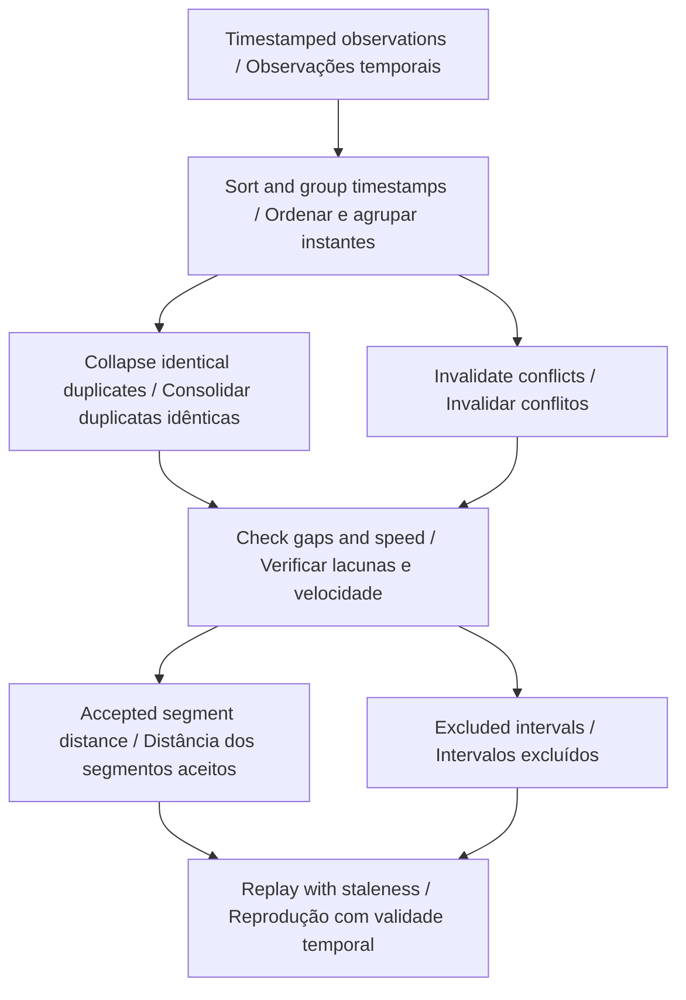
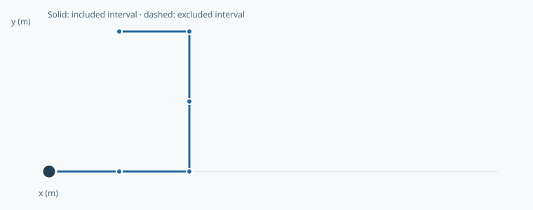
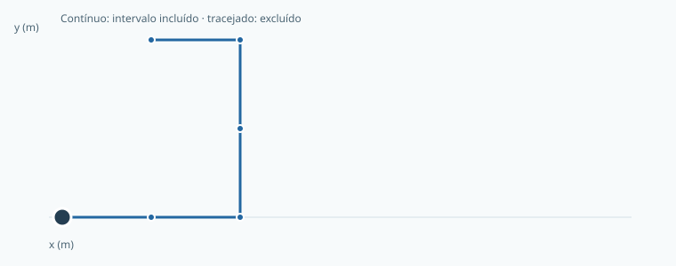

# Go2 PRO Telemetry Replay

**Inspect recorded trajectories and expose gaps in the evidence.**  
**Inspecione trajetórias registradas e identifique lacunas nos dados.**

[](https://github.com/galafis/go2-pro-telemetry-replay/actions/workflows/ci.yml) · **v0.1.0** · **28 automated tests / testes automatizados** · **MIT**

[English](#english) · [Português](#portugues) · [Live workbench · Demonstração](https://galafis.github.io/go2-pro-telemetry-replay/) · [Examples · Exemplos](#examples)

<!-- domain-workflow:start -->

## Domain workflow · Fluxo do domínio



<!-- domain-workflow:end -->

<a id="english"></a>

## English

A read-only offline workbench for timestamped planar observations. It separates usable trajectory segments from gaps, invalid samples, conflicting timestamps and configured speed outliers.

This is a software workbench in a research portfolio centered on the Unitree Go2 PRO. The current release runs independently of physical hardware.

### What works today

- Timestamp normalization with explicit disorder and duplicate reports.
- Conflicting same-time observations invalidate the shared anchor.
- Distance totals include only qualified adjacent intervals.
- Zero-order-hold replay with age and staleness indicators.
- A documented export path into Go2 PRO Clearance Bench for contiguous traces.



### Run it locally

Use **Node.js 22 or newer**. There are no third-party runtime packages to install.

```sh
git clone https://github.com/galafis/go2-pro-telemetry-replay.git
cd go2-pro-telemetry-replay
npm test
npm start
```

Open **http://127.0.0.1:4173**. The browser includes an English/Portuguese switch. Choose an example, adjust the primary assumption, and select **Update**. Expand **Edit all scenario fields** for the complete JSON editor. Invalid imports leave the last valid result visible with an explicit error message. Export both the scenario and report to preserve the experiment.

For headless use:

```sh
node scripts/analyze.mjs examples/nominal.json report.json
npm run examples
npm run test:coverage
```

The command-line exit codes are **0** for completed analysis or review notes, **2** for a valid scenario that needs review, and **1** for invalid input or invocation. A review-required result is still written to the requested report file.

### An experiment you can reproduce

The nominal six-sample polyline totals 2.5 m over 5,000 ms. Every segment travels 0.5 m in one second. Reducing maxGapMs from 1,500 to 999 excludes all five intervals; the result reports zero included distance instead of pretending that the observations are continuous.

### How the result is calculated

- Sort observations by timestamp while preserving source order within equal-time groups.
- Identical repeated samples collapse to one sample. Conflicting samples at one timestamp become an invalid anchor, excluding both neighboring intervals.
- An interval contributes distance only if both endpoints are valid, its gap is no larger than maxGapMs and its derived speed is no larger than speedLimitMps.

```text
included distance = Σ hypot(Δx, Δy) over accepted adjacent intervals / distância incluída = Σ hipot(Δx, Δy) nos intervalos adjacentes aceitos
```

The [architecture guide](docs/ARCHITECTURE.md) explains every rule and boundary case. The [data contract](docs/DATA_CONTRACT.md) documents fields, units, limits and the report envelope. [Research scope](docs/RESEARCH_SCOPE.md) separates implemented behavior from future platform work.

### What the result does not establish

The JSON format is a public project schema, not a Unitree wire protocol. There is no live robot connection, sensor decoder, localization correction or motion control. Included distance is a quality-filtered sum under supplied assumptions and can underestimate travel when data are excluded.

### Where this fits

Prepare a measured closed course and record independent observations using supported controls. Confirm any read-only interface before implementing a vendor adapter. Compare timestamp units, coordinate frame, validity flags and sampling intervals. Keep interrupted and incomplete records as part of the evaluation.

Related public project: [go2-pro-clearance-bench](https://github.com/galafis/go2-pro-clearance-bench). Each repository is independently runnable; a link does not imply a live integration. See [integration notes](docs/INTEGRATION.md) for the exact supported exchange, where present.

[Back to language navigation](#english)

---

<a id="portugues"></a>

## Português

Uma bancada offline, somente de leitura, para observações planas com registro de tempo. Separa segmentos de trajetória utilizáveis de lacunas, amostras inválidas, instantes conflitantes e valores de velocidade acima do limite configurado.

Esta é uma bancada de software de um portfólio de pesquisa centrado no Unitree Go2 PRO. A versão atual funciona independentemente de hardware físico.

### O que já funciona

- Normalização dos instantes com registro explícito de desordem e duplicatas.
- Observações conflitantes no mesmo instante invalidam a referência compartilhada.
- Os totais de distância incluem apenas intervalos adjacentes qualificados.
- Reprodução mantendo a última amostra, com indicação de idade e validade temporal.
- Caminho de exportação documentado para o Go2 PRO Clearance Bench em trajetórias contínuas.



### Executar localmente

Use **Node.js 22 ou mais recente**. Não há pacotes externos de execução para instalar.

```sh
git clone https://github.com/galafis/go2-pro-telemetry-replay.git
cd go2-pro-telemetry-replay
npm test
npm start
```

Abra **http://127.0.0.1:4173**. O navegador oferece alternância entre português e inglês. Escolha um exemplo, ajuste a hipótese principal e selecione **Atualizar**. Expanda **Editar todos os campos do cenário** para acessar o editor JSON completo. Importações inválidas mantêm o último resultado válido visível com mensagem explícita de erro. Exporte o cenário e o relatório para preservar o experimento.

Para usar sem interface gráfica:

```sh
node scripts/analyze.mjs examples/nominal.json report.json
npm run examples
npm run test:coverage
```

Os códigos de saída são **0** para análise concluída ou com notas, **2** para cenário válido que exige revisão e **1** para entrada ou chamada inválida. Resultados que exigem revisão também são gravados no arquivo de relatório solicitado.

### Um experimento reproduzível

A linha poligonal nominal de seis amostras totaliza 2,5 m em 5.000 ms. Cada segmento percorre 0,5 m em um segundo. Reduzir maxGapMs de 1.500 para 999 exclui os cinco intervalos; o resultado informa distância incluída igual a zero, sem presumir continuidade das observações.

### Como o resultado é calculado

- Ordene as observações por instante, preservando a ordem de origem dentro dos grupos de mesmo instante.
- Amostras repetidas idênticas são consolidadas. Amostras conflitantes no mesmo instante criam uma referência inválida, excluindo os dois intervalos vizinhos.
- Um intervalo contribui para a distância somente se os dois extremos forem válidos, o intervalo não exceder maxGapMs e a velocidade derivada não exceder speedLimitMps.

```text
included distance = Σ hypot(Δx, Δy) over accepted adjacent intervals / distância incluída = Σ hipot(Δx, Δy) nos intervalos adjacentes aceitos
```

O [guia de arquitetura](docs/ARCHITECTURE.md) explica todas as regras e os casos limite. O [contrato de dados](docs/DATA_CONTRACT.md) documenta campos, unidades, limites e o formato do relatório. O [escopo de pesquisa](docs/RESEARCH_SCOPE.md) separa funcionalidades implementadas de futuras etapas com a plataforma.

### O que o resultado não comprova

O formato JSON é um esquema público do projeto, não um protocolo de comunicação da Unitree. Não há conexão com robô, decodificação de sensores, correção de localização ou controle de movimento. A distância incluída é uma soma filtrada segundo hipóteses informadas e pode subestimar o percurso quando dados são excluídos.

### Como este projeto se conecta ao portfólio

Prepare um percurso fechado medido e registre observações independentes usando controles compatíveis. Confirme qualquer interface de leitura antes de implementar um adaptador do fabricante. Compare unidades de tempo, sistema de coordenadas, indicadores de validade e intervalos de amostragem. Mantenha registros interrompidos e incompletos na avaliação.

Projeto público relacionado: [go2-pro-clearance-bench](https://github.com/galafis/go2-pro-clearance-bench). Cada repositório funciona independentemente; um link não implica integração em tempo real. Consulte as [notas de integração](docs/INTEGRATION.md) para conhecer as trocas efetivamente suportadas, quando existentes.

---

<a id="examples"></a>

## Reproducible examples · Exemplos reproduzíveis

| Example · Exemplo                             | Result · Resultado | Reproduce · Reproduzir                                                                                                    |
| --------------------------------------------- | ------------------ | ------------------------------------------------------------------------------------------------------------------------- |
| Closed course<br>Percurso fechado             | `complete`         | [Input · Entrada](examples/nominal.json) · [Report · Relatório](examples/nominal.report.json)                             |
| Missing observations<br>Observações ausentes  | `review-notes`     | [Input · Entrada](examples/missing-observations.json) · [Report · Relatório](examples/missing-observations.report.json)   |
| Conflicting timestamp<br>Instante conflitante | `review-required`  | [Input · Entrada](examples/conflicting-timestamp.json) · [Report · Relatório](examples/conflicting-timestamp.report.json) |

## Project guide · Guia do projeto

| Document · Documento                                          | Content · Conteúdo                                                                    |
| ------------------------------------------------------------- | ------------------------------------------------------------------------------------- |
| [Architecture · Arquitetura](docs/ARCHITECTURE.md)            | Domain rules, algorithms and boundaries · Regras, algoritmos e limites                |
| [Data contract · Contrato de dados](docs/DATA_CONTRACT.md)    | Fields, units and JSON format · Campos, unidades e formato JSON                       |
| [Schema](schemas/scenario.schema.json)                        | Structural JSON Schema · Esquema estrutural JSON                                      |
| [Validation · Validação](docs/VALIDATION.md)                  | Behavioral tests and review protocol · Testes de comportamento e protocolo de revisão |
| [Research scope · Escopo de pesquisa](docs/RESEARCH_SCOPE.md) | Platform relationship and next steps · Relação com a plataforma e próximas etapas     |
| [Integration · Integração](docs/INTEGRATION.md)               | Public artifact exchange · Troca de artefatos públicos                                |
| [Contributing · Contribuições](CONTRIBUTING.md)               | Development and review · Desenvolvimento e revisão                                    |
| [Security · Segurança](SECURITY.md)                           | Privacy and responsible reports · Privacidade e relatos responsáveis                  |
| [Changelog · Histórico](CHANGELOG.md)                         | Versioned changes · Alterações por versão                                             |

## Maintainer · Responsável

**Gabriel Demetrios Lafis** · Brazil / Brasil  
**[gabrieldemetrioslafis@usp.br](mailto:gabrieldemetrioslafis@usp.br)** · [GitHub](https://github.com/galafis)

Independent work; institutional contact does not imply institutional or vendor endorsement.  
Trabalho independente; o contato institucional não implica endosso de instituição ou fabricante.

[Worked examples with expected metrics · Exemplos comentados com métricas esperadas](docs/EXPERIMENTS.md)
