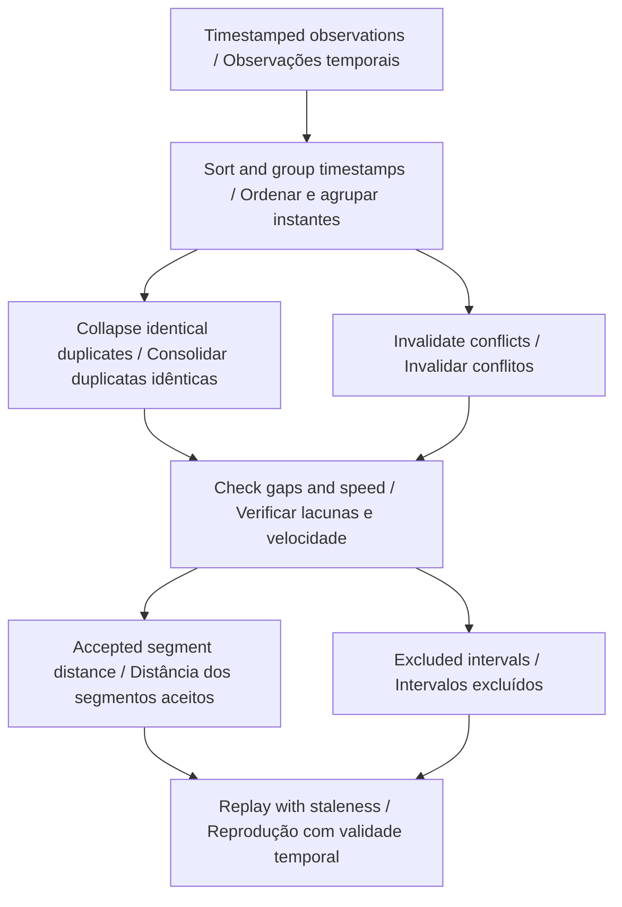

# Architecture · Arquitetura

[README](../README.md) · [Data contract · Contrato de dados](DATA_CONTRACT.md)

## English

The domain engine in `src/engine.js` is independent of the document, network and local storage. The same `run(input)` function powers the browser and command-line interface. Awaiting it works for every project, including the asynchronous journal hashing operation.

```text
scenario JSON → strict validation → deterministic domain engine → report
                                                           ↘ bilingual view
```

- Sort observations by timestamp while preserving source order within equal-time groups.
- Identical repeated samples collapse to one sample. Conflicting samples at one timestamp become an invalid anchor, excluding both neighboring intervals.
- An interval contributes distance only if both endpoints are valid, its gap is no larger than maxGapMs and its derived speed is no larger than speedLimitMps.
- The speed limit is an analysis assumption supplied by the scenario. Excluded outliers remain visible in the review records.
- The cursor returns the latest sample at or before the requested time. It never interpolates a route through missing observations.
- Held samples become stale when age exceeds maxGapMs; invalid samples are stale immediately. Battery increases produce review notes because charging and measurement context may explain them.

### Model

```text
included distance = Σ hypot(Δx, Δy) over accepted adjacent intervals / distância incluída = Σ hipot(Δx, Δy) nos intervalos adjacentes aceitos
```

Inputs are checked before computation and are not mutated. Unknown keys are rejected at the validated scenario and nested-domain boundaries. Reports contain no wall-clock creation timestamp, so the same input produces identical JSON under the same analysis version. UI formatting changes decimal separators without changing exported numeric values.

The browser parses imports locally, limits them to 1 MB, renders supplied text through escaping, and discards stale asynchronous results using a revision counter. It retains only the language preference automatically. Charts are previews; complete records remain in exports. The local development server binds to `127.0.0.1` and rejects hidden or out-of-root paths.

## Português

O mecanismo de domínio em `src/engine.js` é independente do documento, da rede e do armazenamento local. A mesma função `run(input)` atende ao navegador e à interface de linha de comando. Ela pode ser aguardada com `await` em todos os projetos, inclusive no cálculo assíncrono dos hashes do registro.

```text
cenário JSON → validação estrita → mecanismo determinístico → relatório
                                                       ↘ visualização bilíngue
```

- Ordene as observações por instante, preservando a ordem de origem dentro dos grupos de mesmo instante.
- Amostras repetidas idênticas são consolidadas. Amostras conflitantes no mesmo instante criam uma referência inválida, excluindo os dois intervalos vizinhos.
- Um intervalo contribui para a distância somente se os dois extremos forem válidos, o intervalo não exceder maxGapMs e a velocidade derivada não exceder speedLimitMps.
- O limite de velocidade é uma hipótese de análise informada no cenário. Valores excluídos continuam visíveis nos registros de revisão.
- O cursor retorna a última amostra no instante solicitado ou antes dele. Não interpola trajetórias por observações ausentes.
- A amostra mantida fica desatualizada quando sua idade excede maxGapMs; amostras inválidas são desatualizadas imediatamente. Aumentos de bateria geram notas, pois carga e contexto de medição podem explicá-los.

As entradas são verificadas antes do cálculo e não são alteradas. Chaves desconhecidas são rejeitadas no cenário e nas estruturas de domínio validadas. Os relatórios não incluem horário real de criação; assim, a mesma entrada produz JSON idêntico sob a mesma versão da análise. A formatação visual altera separadores decimais sem alterar os valores numéricos exportados.

O navegador lê as importações localmente, limita-as a 1 MB, escapa textos informados antes da exibição e descarta resultados assíncronos antigos com um contador de revisão. Apenas a preferência de idioma é armazenada automaticamente. Os gráficos são prévias; os registros completos permanecem na exportação. O servidor local atende em `127.0.0.1` e rejeita caminhos ocultos ou externos à pasta.

## Files · Arquivos

| Path · Caminho        | Responsibility · Responsabilidade                                                       |
| --------------------- | --------------------------------------------------------------------------------------- |
| `src/engine.js`       | Domain behavior · Comportamento de domínio                                              |
| `src/validation.js`   | Strict primitives and report contract · Validação e contrato do relatório               |
| `src/view.js`         | Project-specific chart and interpretation · Gráfico e interpretação próprios do projeto |
| `src/app.js`          | Browser workflow, imports and language · Fluxo do navegador, importações e idioma       |
| `src/ui.js`           | Escaping, formatting and downloads · Escape de texto, formatação e downloads            |
| `scripts/analyze.mjs` | Command-line adapter · Adaptador de linha de comando                                    |
| `tests/`              | Behavioral and contract checks · Verificações de comportamento e contrato               |
| `examples/`           | Synthetic inputs and expected reports · Entradas sintéticas e relatórios esperados      |

## Domain decision flow · Fluxo de decisões do domínio


