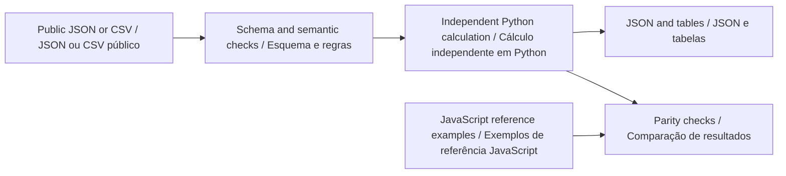

# Python offline guide · Guia Python offline

[English](#english) · [Português](#portugues) · [Project / Projeto](../README.md)

**Python companion v0.2.0 · Python 3.11+ · Python · SQL · JavaScript**



<a id="english"></a>

## English

Import timestamped CSV observations, review gaps and conflicting samples in Python, and archive raw input plus canonical interval analysis in SQLite. This provides a reproducible path from a manually annotated training exercise to an offline review.

### Install and run

From the repository root, create a virtual environment with `python -m venv .venv`. Activate it with `.venv\Scripts\Activate.ps1` in PowerShell or `source .venv/bin/activate` in a Unix shell. Use `python3` instead of `python` if required by your installation.

```sh
python -m pip install -r requirements-python.txt .
python -m go2_telemetry --help
python -m go2_telemetry analyze examples/nominal.json review-output/nominal.report.json
python -m go2_telemetry import-csv examples/nominal.json examples/python/input.csv review-output/imported.scenario.json
python -m go2_telemetry analyze review-output/imported.scenario.json review-output/imported.report.json
python -m go2_telemetry store examples/nominal.json review-output/analysis.sqlite
python -m go2_telemetry query review-output/analysis.sqlite review-output/sql-review.json
```

The first analysis creates `review-output/`. Use a new SQLite filename for a new archive, when applicable. Reimporting the same scenario identifier is rejected to preserve the previous record. Runtime calculations require Python and the declared schema-validation dependencies; Node is needed only for the browser application and cross-language tests.

### Method and worked example

Sort timestamps stably. Collapse identical duplicates; mark conflicting timestamps invalid. Include a segment only when both endpoints are valid, its time gap is within maxGapMs and its speed is at most speedLimitMps. The review cursor uses zero-order hold and exposes staleness; it never interpolates across a missing observation.

```text
speedMps = hypot(deltaX, deltaY) / (gapMs / 1000)
included = validEndpoints and gapMs <= maxGapMs and speedMps <= speedLimitMps
```

input.csv contains the same samples as the nominal browser scenario. import-csv replaces only the sample array in that supplied scenario template, validates the result and writes a browser-compatible JSON file. The SQL review separates included and excluded intervals; a single sample has a null inclusion percentage because it defines no interval.

Browse the [committed inputs and outputs](../examples/python/README.md). CSV column order and names must match the example header exactly. Missing columns, extra columns, malformed numbers, duplicate identifiers and non-finite values are rejected where applicable. JSON rejects unknown fields and duplicate object keys. The public [scenario schema](../schemas/scenario.schema.json) defines units and field bounds; the domain module adds relationships that JSON Schema alone cannot express.

### Use as a library

```python
from pathlib import Path
from go2_telemetry import analyze
from go2_telemetry.contract import read_json

scenario = read_json(Path("examples/nominal.json"))
result = analyze(scenario)
print(result["scenarioId"])
```

See the [calculation module](../python/go2_telemetry/core.py) and [CLI](../python/go2_telemetry/__main__.py). The Python result is a documented offline summary, not the complete bilingual browser report envelope. Shared numerical fields and paths are independently compared; matching output is a software consistency check, not physical validation.

### Verify

Install Node.js 22+ for the independent JavaScript comparisons, then run:

```sh
python -m unittest discover -s python/tests -v
python scripts/check-python-examples.py
npm test
```

The Python suite covers the strict public contract, unchanged inputs, invalid-file handling, preservation of previous outputs, domain boundaries and every canonical example listed in `examples/index.json`. The example checker executes the documented workflows in a temporary directory and compares JSON/CSV artifacts. Use its `--write` option only after intentionally reviewing a changed result. CLI exit status is 0 for a completed calculation and 1 for invalid input or a failed integrity check. Inspect result flags for review conditions; this differs from the browser CLI's status-2 convention.

### Interpretation boundary

Observed distance omits excluded motion and is not a reconstruction of the complete route. The public CSV is a generic observation contract, not a Unitree protocol. SQL stores rounded segment values separately from the total accumulated before rounding, so tiny rounding differences are expected.

Go2 PRO remains the proposed observation platform. These tools contain no robot commands, and custom SDK support on standard PRO hardware is not assumed. See the [hardware study plan](RESEARCH_SCOPE.md).

### SQL archive

The [schema](../python/go2_telemetry/sql/schema.sql), [review query](../python/go2_telemetry/sql/review.sql) and [transactional importer](../python/go2_telemetry/storage.py) are executable parts of the package. Parameterized inserts avoid interpreting input as SQL. Foreign keys are enabled by `connect()`. Each import is atomic; duplicate scenario identifiers fail without replacement. Query results retain explicit denominators. The database remains a local analysis artifact and is excluded from version control.

<a id="portugues"></a>

## Português

Importe observações temporais em CSV, revise lacunas e conflitos em Python e arquive a entrada original e a análise canônica de intervalos em SQLite. Isso oferece um caminho reproduzível de um exercício anotado manualmente até sua revisão offline.

### Instalação e execução

Na raiz do repositório, crie o ambiente com `python -m venv .venv`. Ative com `.venv\Scripts\Activate.ps1` no PowerShell ou `source .venv/bin/activate` em um shell Unix. Use `python3` se essa for a nomenclatura da instalação. Execute a sequência de comandos da seção inglesa: ela é a mesma nos dois idiomas. A primeira análise cria `review-output/`.

Instale com `python -m pip install -r requirements-python.txt .`. Os cálculos dependem de Python e das dependências declaradas para validação de esquema. Node.js 22+ é necessário somente para o aplicativo de navegador e para os testes entre linguagens. Quando houver SQLite, use um arquivo novo para um novo arquivo de análise; identificadores de cenário repetidos são rejeitados, preservando os registros existentes.

### Método e exemplo explicado

Ordene os instantes de forma estável. Consolide duplicatas idênticas; marque instantes conflitantes como inválidos. Inclua um segmento apenas quando ambos os extremos forem válidos, a lacuna respeitar maxGapMs e a velocidade não superar speedLimitMps. O cursor mantém a última amostra e indica sua defasagem; nunca interpola observações ausentes.

input.csv contém as mesmas amostras do cenário nominal no navegador. import-csv substitui apenas o vetor de amostras do modelo informado, valida o resultado e grava um JSON compatível com o navegador. A revisão SQL separa intervalos incluídos e excluídos; uma amostra isolada possui porcentagem de inclusão nula porque não define intervalo.

As fórmulas e os comandos acima usam nomes de campos estáveis, compartilhados pelos dois idiomas. Consulte as [entradas e saídas versionadas](../examples/python/README.md). Cabeçalhos CSV devem corresponder exatamente ao exemplo, incluindo a ordem. Colunas ausentes ou extras, números malformados, identificadores duplicados e valores não finitos são rejeitados quando aplicável. JSON rejeita campos desconhecidos e chaves repetidas. O [esquema público](../schemas/scenario.schema.json) define unidades e limites; o módulo de domínio valida relações adicionais.

### Biblioteca e validação

O exemplo Python da seção inglesa funciona diretamente. O [módulo de cálculo](../python/go2_telemetry/core.py) retorna um resumo offline documentado; ele não replica todo o envelope bilíngue do relatório de navegador. Os campos numéricos e caminhos compartilhados são comparados independentemente. Concordância é uma verificação de consistência do software, não validação física.

Execute `python -m unittest discover -s python/tests -v`, `python scripts/check-python-examples.py` e `npm test`. A suíte Python cobre o contrato, preservação de entradas, arquivos inválidos, manutenção da saída anterior, limites do domínio e todos os exemplos canônicos do índice. O verificador executa os fluxos em diretório temporário e compara os artefatos JSON/CSV. Use `--write` somente após revisar uma mudança intencional. O código de saída é 0 para cálculo concluído e 1 para entrada inválida ou falha de integridade. Consulte as sinalizações do resultado; a convenção difere do código 2 da interface de análise em JavaScript.

### Limites de interpretação

A distância observada omite movimentos excluídos e não reconstrói a rota completa. O CSV público é um contrato genérico de observação, não um protocolo Unitree. O SQL armazena segmentos arredondados separadamente do total acumulado antes do arredondamento; pequenas diferenças de arredondamento são esperadas.

O Go2 PRO continua como plataforma proposta de observação. Estas ferramentas não contêm comandos de robô nem pressupõem suporte a SDK personalizado no PRO padrão. Consulte o [plano de estudo com hardware](RESEARCH_SCOPE.md).

### Arquivo SQL

O [esquema](../python/go2_telemetry/sql/schema.sql), a [consulta de revisão](../python/go2_telemetry/sql/review.sql) e o [importador transacional](../python/go2_telemetry/storage.py) são executáveis. Inserções parametrizadas evitam interpretar entradas como SQL. `connect()` habilita chaves estrangeiras. Cada importação é atômica; identificadores repetidos falham sem substituir dados. Denominadores ficam explícitos nas consultas. O banco é um artefato local de análise, excluído do controle de versão.
